<picture>
  <source media="(prefers-color-scheme: dark)" srcset="./assets/header-dark.svg">
  
</picture>

  <a href="https://opitekya.com"><b>opitekya.com</b></a>
  &nbsp;·&nbsp;
  <a href="#şu-an">Şu an</a>
  &nbsp;·&nbsp;
  <a href="#yığın">Yığın</a>
  &nbsp;·&nbsp;
  <a href="#yaklaşım">Yaklaşım</a>

Bir ürünün **bütün katmanlarını** tek elden kuruyorum: backend API, WebRTC medya katmanı, native C/C++ ekran yakalama, Kubernetes ve gözlem stack'i. En çok düşük gecikmenin önemli olduğu yerde çalışmayı seviyorum.

## Şu an

**[Opitekya](https://opitekya.com)** — ekipler ve topluluklar için güvenli, gerçek zamanlı iletişim platformu. Sesli sohbet, native GPU ile video/ekran yayını, anlık mesajlaşma ve masaüstü uygulaması. `production`

<picture>
  <source media="(prefers-color-scheme: dark)" srcset="./assets/architecture-dark.svg">
  
</picture>

## Yığın

<picture>
  <source media="(prefers-color-scheme: dark)" srcset="./assets/stack-dark.svg">
  
</picture>

## Yaklaşım

- **Uçtan uca sahiplik** — tasarımdan deploy'a, bir özelliği başka birine devretmeden bitirmek.
- **Önce ölç, sonra optimize et** — her servis metrik ve trace ile doğar, tahminle değil.
- **Gecikme bir özelliktir** — medya yolu her katmanda ayrı bir bütçe olarak ele alınır.

 

  <picture>
    <source media="(prefers-color-scheme: dark)" srcset="https://streak-stats.demolab.com?user=ahhmttdmr&hide_border=true&background=00000000&ring=818CF8&fire=818CF8&currStreakNum=E6EDF3&currStreakLabel=818CF8&sideNums=E6EDF3&sideLabels=8B949E&dates=8B949E&stroke=30363D">
    
  </picture>

<picture>
  <source media="(prefers-color-scheme: dark)" srcset="./assets/footer-dark.svg">
  
</picture>
